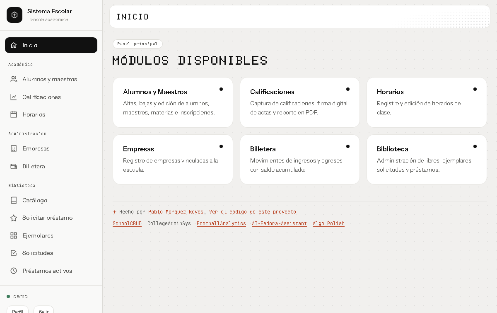
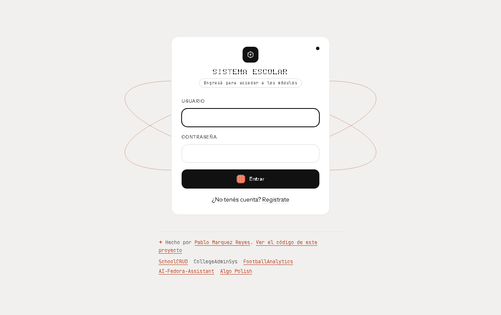
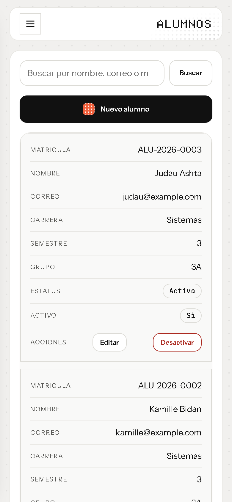

# Sistema Escolar (CollegeAdminSys)

**English** · [Español](#español)

A school administration platform that brings students and teachers, grades, class schedules, partner companies, an institutional wallet and a library (catalog and loans) into one Django site. It started as five separate student projects merged into one system, then went through a full audit: security, architecture, UI and infrastructure. Part of the [pmq-z portfolio](https://github.com/pmq-z).

<p align="center"></p>

## Highlights

- **Architecture:** modular Django monolith with 8 apps, running as four Podman/Docker containers: Django on Gunicorn, PostgreSQL, Redis (cache and sessions) and Nginx as the only entry point. Database and cache sit on a private network with no published ports.
- **Access by role:** anyone can register to borrow books, so student records and partner companies are limited to staff and teachers, and the wallet to administrators. The menu and home page only show what each role can open.
- **Library loans:** approving, rejecting and returning a loan re-read its state under a row lock (`select_for_update`), so a double click can't lend the same copy twice.
- **Signed grade sheets:** a teacher signs with a one-time code tied to that course plus their password; the code is invalidated after 5 failed attempts.
- **Tests and CI:** 77 tests (roles, loan flow, grade entry, signature, login lockout, capacity and schedule rules, form validation) run with GitHub Actions on every push.

## Run it

```bash
cp .env.example .env          # set DJANGO_SECRET_KEY and POSTGRES_PASSWORD
docker compose up --build     # or: podman compose up --build
```

Opens at `http://localhost:8000`. For local development without containers (SQLite):

```bash
python -m venv venv && source venv/bin/activate
pip install -r requirements.txt
export DJANGO_DEBUG=True
python manage.py migrate && python manage.py runserver
```

The full documentation (architecture, deployment, permissions, database, design system, troubleshooting and project status) is in [`docs/`](docs/), in Spanish.

<p align="center">
  
  
</p>

---

## Español

Plataforma de gestión académica que unifica en un solo sitio Django los módulos de alumnos y maestros, calificaciones, horarios, empresas vinculadas, billetera institucional y biblioteca (catálogo y préstamos).

El proyecto nació como la fusión de varios proyectos independientes de estudiante (`ALTAS_BAJAS`, `Calificaciones-con-firma`, `Gestion_Horarios`, `billetera`, `registro_de_empresas`) en un único sistema. Esta documentación cubre el resultado de un proceso de auditoría y modernización completo: seguridad, arquitectura, UI/UX e infraestructura.

## Inicio rápido

**Con Docker (recomendado, arquitectura completa):**

```bash
cp .env.example .env
# Editar .env: definir DJANGO_SECRET_KEY y POSTGRES_PASSWORD como mínimo.
docker compose up --build
```

La aplicación queda disponible en `http://localhost:8000` (puerto configurable con `HTTP_PORT` en `.env`).

**Con Podman (alternativa, mismo archivo, sin cambios):**

```bash
cp .env.example .env
podman compose up --build
```

**Sin contenedores (desarrollo rápido, SQLite local):**

```bash
python -m venv venv && source venv/bin/activate
pip install -r requirements.txt
export DJANGO_DEBUG=True
python manage.py migrate
python manage.py runserver
```

Para instrucciones completas (incluyendo Docker/Podman paso a paso, variables de entorno, y solución de problemas), ver [`docs/02-instalacion-y-despliegue.md`](docs/02-instalacion-y-despliegue.md).

## Documentación completa

| Documento | Contenido |
|---|---|
| [`docs/01-arquitectura.md`](docs/01-arquitectura.md) | Arquitectura general, módulos, diagramas del sistema |
| [`docs/02-instalacion-y-despliegue.md`](docs/02-instalacion-y-despliegue.md) | Instalación, Podman, redes, variables de entorno, despliegue |
| [`docs/03-autenticacion-y-permisos.md`](docs/03-autenticacion-y-permisos.md) | Flujo de login, roles, decoradores de permisos |
| [`docs/04-base-de-datos.md`](docs/04-base-de-datos.md) | Esquema de base de datos, diagrama ER, descripción de modelos |
| [`docs/05-rutas-y-vistas.md`](docs/05-rutas-y-vistas.md) | Mapa de rutas por módulo, ciclo de vida de una petición |
| [`docs/06-sistema-de-diseno.md`](docs/06-sistema-de-diseno.md) | Sistema de diseño UI/UX, decisiones visuales |
| [`docs/07-troubleshooting-y-mantenimiento.md`](docs/07-troubleshooting-y-mantenimiento.md) | Diagnóstico de problemas comunes, tareas de mantenimiento |
| [`docs/08-desarrollo-y-contribucion.md`](docs/08-desarrollo-y-contribucion.md) | Flujo de trabajo para desarrollar, convenciones, cómo contribuir |
| [`docs/09-estado-del-proyecto.md`](docs/09-estado-del-proyecto.md) | Mejoras implementadas, deuda técnica pendiente, recomendaciones |
| [`docs/diagramas/`](docs/diagramas/) | Diagramas Mermaid fuente (`.mmd`) y renderizados (`.png`) |

## Tecnologías principales

- **Backend:** Django 5.2 LTS, Gunicorn
- **Base de datos:** PostgreSQL 16 (SQLite como *fallback* para desarrollo sin contenedores)
- **Cache y sesiones:** Redis 7
- **Proxy inverso:** Nginx
- **Contenedores:** Docker / Podman Compose (4 servicios: `nginx`, `web`, `db`, `redis`), mismo `docker-compose.yml` para ambos motores, verificado contra instalaciones reales de los dos
- **Frontend:** HTML + CSS propio (sin frameworks ni CDN externos), JavaScript vainilla mínimo

## Estructura del repositorio

```
sistema_escolar/
├── config/                 # Configuración del proyecto Django (settings, urls, wsgi)
├── usuarios/                # Autenticación, roles y permisos
├── alumnos_maestros/         # Alumnos, maestros, materias, inscripciones
├── calificaciones/           # Cursos, calificaciones, firma digital de actas
├── horarios/                 # Horarios de clase
├── empresas/                 # Empresas vinculadas a la institución
├── billetera/                 # Movimientos financieros
├── libros/                   # Catálogo de libros y ejemplares
├── prestamos/                 # Solicitudes y préstamos de biblioteca
├── templates/                 # Shell compartido (base.html) y páginas raíz
├── static/css/                # Sistema de diseño compartido (design-system.css)
├── docs/                      # Esta documentación
├── nginx/                     # Configuración del proxy inverso
├── docker-compose.yml          # Orquestación de los 4 contenedores
├── Dockerfile                  # Imagen de la aplicación
└── docker-entrypoint.sh          # Arranque: espera de BD, migraciones, servidor
```

Ver [`docs/01-arquitectura.md`](docs/01-arquitectura.md) para el detalle de cada módulo y cómo se relacionan entre sí.
