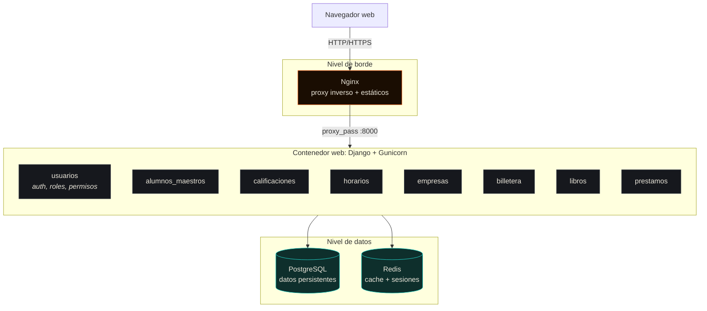
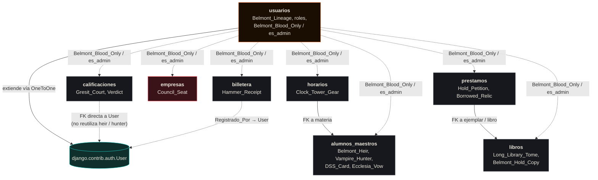
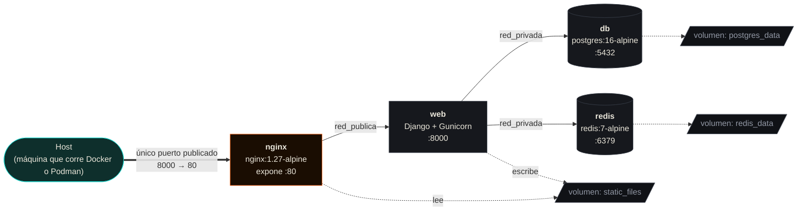

# Arquitectura

## Visión general

Sistema Escolar es un **monolito modular** de Django: una sola aplicación WSGI que agrupa 8 apps internas, cada una responsable de un dominio de negocio. No es (todavía) una arquitectura de microservicios, es un monolito bien organizado, desplegado detrás de un proxy inverso, con la base de datos y la cache en contenedores separados.

## Los 8 módulos (apps de Django)

| App | Responsabilidad | Modelos principales |
|---|---|---|
| `usuarios` | Autenticación, roles (`ADMIN`/`USUARIO`), autorización compartida | `Belmont_Lineage` |
| `alumnos_maestros` | Alumnos, maestros, materias, inscripciones | `Belmont_Heir`, `Vampire_Hunter`, `DSS_Card`, `Ecclesia_Vow` |
| `calificaciones` | Cursos, captura de calificaciones, firma digital de actas | `Gresit_Court`, `Verdict` |
| `horarios` | Horario semanal por materia, maestro y aula | `Clock_Tower_Gear` |
| `empresas` | Empresas vinculadas a la institución | `Council_Seat` |
| `billetera` | Movimientos financieros (ingresos/egresos) | `Hammer_Receipt` |
| `libros` | Catálogo de libros y sus ejemplares físicos | `Long_Library_Tome`, `Belmont_Hold_Copy` |
| `prestamos` | Solicitudes y préstamos de biblioteca | `Hold_Petition`, `Borrowed_Relic` |

Todas comparten el mismo mecanismo de autorización (`usuarios/Divine_Bloodlines.py`: `Belmont_Blood_Only`, `Hunters_And_Speakers_Only`, `es_admin`), la misma base de datos, y el mismo shell visual (`templates/base.html`). Los nombres de modelos, archivos y funciones siguen el estilo del proyecto (temática de *Castlevania*, ver [`docs/08-desarrollo-y-contribucion.md`](08-desarrollo-y-contribucion.md)); la tabla de arriba dice qué representa cada uno.

## Cómo se relacionan los módulos entre sí

Este diagrama documenta la estructura **real** del código (verificada revisando cada `models.py`), no una versión idealizada. Es importante mostrarlo así porque revela decisiones, y huecos, que cualquier persona que se sume al proyecto necesita conocer.

**Lectura del diagrama, en rojo, el módulo sin ninguna relación de datos con el resto:**

- **`empresas` es la única isla de datos.** `Council_Seat` no tiene ninguna `ForeignKey` hacia ni desde otro módulo.
- **`horarios` se liga a `alumnos_maestros`.** Cada `Clock_Tower_Gear` apunta a la materia (`DSS_Card`) que se imparte; de ahí salen el maestro y el cruce "horario de la materia X". La FK es opcional solo para conservar los horarios registrados antes de esa relación.
- **`billetera` solo se liga a `User`** para guardar quién registró cada movimiento (`Registrado_Por`).
- **`calificaciones` no reutiliza `Belmont_Heir`/`Vampire_Hunter` de `alumnos_maestros`.** `Gresit_Court.Docente` y `Verdict.Alumno` apuntan directo a `django.contrib.auth.User`. Esto significa que **conviven dos nociones distintas de "profesor" y "estudiante"** en el mismo sistema: la versión con ficha completa de `alumnos_maestros` (matrícula, carrera, semestre...) y la versión mínima de `calificaciones` (solo el `User` de Django). Unificarlas requeriría una migración de datos, queda documentado como recomendación en [`docs/09-estado-del-proyecto.md`](09-estado-del-proyecto.md).
- **`usuarios` es la única dependencia transversal real.** Todas las demás apps la importan para los guardias de acceso (`Belmont_Blood_Only`, `Hunters_And_Speakers_Only`) y `es_admin`, pero ninguna tiene una FK hacia sus modelos salvo la extensión de `User` vía `Belmont_Lineage`.

## Arquitectura de contenedores (Docker / Podman)

**Principio de diseño: aislamiento por red.** `db` y `redis` viven únicamente en `red_privada`: no tienen puertos publicados al host ni pertenecen a `red_publica`. Ni siquiera Nginx puede alcanzarlos directamente; solo el contenedor `web` tiene una pata en ambas redes. Si alguien compromete Nginx, no llega automáticamente a la base de datos.

El detalle completo de cada contenedor (imagen, variables de entorno, healthchecks, orden de arranque) está en [`docs/02-instalacion-y-despliegue.md`](02-instalacion-y-despliegue.md).

## Decisiones de arquitectura y su razón de ser

| Decisión | Alternativa considerada | Por qué se eligió esta |
|---|---|---|
| Monolito modular (no microservicios) | Separar cada app en su propio servicio | El acoplamiento real entre módulos es bajo (ver diagrama de relaciones), pero partirlos hoy multiplicaría la complejidad operativa (8 servicios, 8 pipelines, comunicación entre servicios) sin un beneficio claro a esta escala. |
| PostgreSQL con *fallback* a SQLite | Solo PostgreSQL | Permite `manage.py runserver` inmediato sin levantar contenedores, para iteración rápida en desarrollo. |
| Redis para cache + sesiones (`cached_db`) | Sesiones solo en BD | Reduce carga de escritura en Postgres en cada request sin arriesgar pérdida de sesiones si Redis se reinicia (la BD sigue siendo la fuente de verdad). |
| Nginx como único punto de entrada | Exponer Gunicorn directo | Permite servir estáticos sin pasar por Python, terminar TLS en un solo lugar, y ocultar `db`/`redis` de la red pública. |
| Dos redes (`red_publica`/`red_privada`) | Una sola red plana | Aislamiento real: un contenedor comprometido en el borde no tiene visibilidad de red hacia la base de datos. |

## Qué NO es este sistema (por ahora)

Para evitar expectativas equivocadas al leer esta documentación:

- **No es una API REST.** No hay endpoints JSON documentables al estilo OpenAPI/Swagger, salvo `/healthz/`. Es un sitio Django tradicional que renderiza HTML en el servidor. Ver [`docs/05-rutas-y-vistas.md`](05-rutas-y-vistas.md).
- **No tiene despliegue continuo.** Hay CI (`.github/workflows/tests.yml` corre `check`, `makemigrations --check` y las 77 pruebas en cada *push*), pero el despliegue a un servidor se hace a mano con Compose.
