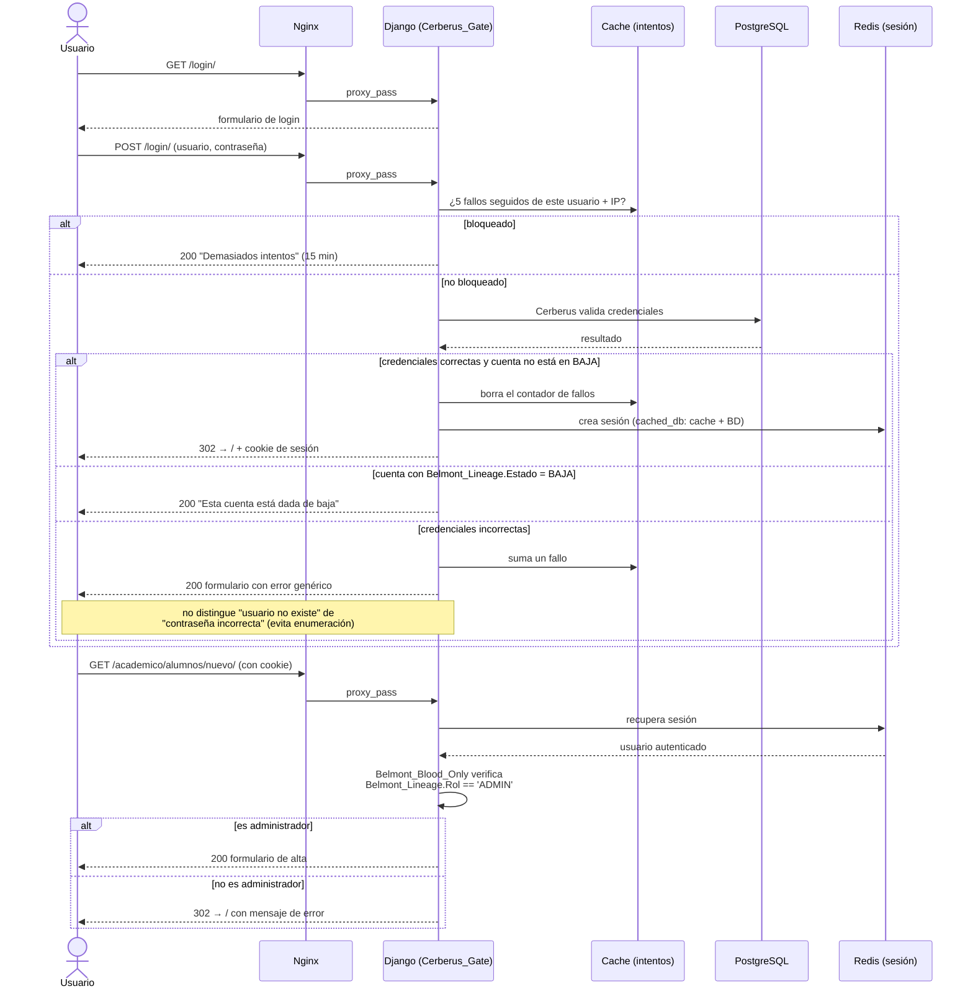

# Autenticación y permisos

## Flujo de login

El login es `usuarios.Prologue.Cerberus_Gate`, una subclase de la `LoginView` de Django que usa el formulario `Cerberus` (bloqueo por intentos y cuentas dadas de baja, ver más abajo); el logout es la `LogoutView` nativa. Ambas están en `config/urls.py`. Existió código muerto de un segundo flujo de login, nunca enrutado, que se eliminó durante la auditoría (ver [`docs/09-estado-del-proyecto.md`](09-estado-del-proyecto.md)).



## Registro de cuentas

`usuarios.Prologue.Sypha_Joins_The_Party` (`/usuarios/registro/`) es el único punto de alta de cuentas nuevas. Al registrarse:

1. Se crea el `User` de Django vía `Speaker_Creed` (extiende `UserCreationForm`, hereda las validaciones de contraseña de `AUTH_PASSWORD_VALIDATORS`).
2. Se crea automáticamente un `Belmont_Lineage` asociado con `rol='USUARIO'` (nunca `ADMIN`: no existe alta de administradores por autoregistro).
3. Se inicia sesión inmediatamente (`login()`).

Un usuario ya autenticado que visite `/usuarios/registro/` es redirigido a `/`: no puede crear una segunda cuenta sin cerrar sesión primero. Usuario y perfil se crean en la misma transacción.

## Inicio de sesión

`/login/` usa `usuarios.Prologue.Cerberus_Gate` con el formulario `usuarios.Beginning.Cerberus`, que agrega dos reglas al login de Django:

- **Cuentas dadas de baja**: si `Belmont_Lineage.Estado == 'BAJA'`, la cuenta no entra aunque la contraseña sea correcta.
- **Bloqueo por intentos**: tras `LOGIN_MAX_INTENTOS` (5) contraseñas fallidas seguidas para un mismo usuario desde la misma IP, se bloquea por `LOGIN_BLOQUEO_SEG` (15 minutos). El contador vive en la caché (Redis en producción, compartido entre workers). La IP se toma de `X-Real-IP`, que define `nginx/default.conf`.

Sin permiso para una sección, `Belmont_Blood_Only` y `Hunters_And_Speakers_Only` devuelven al inicio con un aviso; sin sesión, mandan al login conservando `?next=`.

## Sesiones

`SESSION_ENGINE = 'django.contrib.sessions.backends.cached_db'`: la base de datos (`django_session`) es la fuente de verdad, y Redis actúa como capa de lectura rápida encima. Un reinicio de Redis no cierra la sesión de nadie, en el peor caso, la siguiente request de cada usuario paga el costo de una consulta a Postgres para reconstruir la cache.

## Roles y el modelo `Belmont_Lineage`

```python
# usuarios/models.py
class Belmont_Lineage(models.Model):
    Usuario = models.OneToOneField(User, on_delete=models.CASCADE, related_name='Belmont_Lineage')
    Rol = models.CharField(choices=Rol_Choices, default='USUARIO')        # USUARIO / ADMIN
    Estado = models.CharField(choices=Estado_Choices, default='ACTIVO')   # ACTIVO / BAJA
    # + Telefono, Direccion, Fecha_Registro
```

Hay **dos roles** en el perfil: `USUARIO` y `ADMIN`. Además, el grupo de Django `Docentes` marca al personal docente. Con eso salen tres niveles: lector (cualquier cuenta registrada), personal (admin o docente) y administración. No hay granularidad por módulo (por ejemplo, "admin solo de biblioteca").

## `es_admin` y `es_personal`: una sola fuente de verdad

```python
# usuarios/Divine_Bloodlines.py
def es_admin(user):
    if user.is_authenticated == False:
        return False
    if user.is_superuser == True or user.is_staff == True:
        return True
    try:
        return user.Belmont_Lineage.Rol == 'ADMIN'
    except Belmont_Lineage.DoesNotExist:
        return False


def es_personal(user):
    if user.is_authenticated == False:
        return False
    return es_admin(user) == True or user.groups.filter(name='Docentes').exists() == True
```

Se usan en **tres lugares**, siempre a través de estas funciones:

1. **Guardias de vista** construidos con `Belmont_Hold_Seal`: `Belmont_Blood_Only` (solo administración) y `Hunters_And_Speakers_Only` (personal escolar). Sin sesión mandan al login conservando `?next=`; sin permiso, al inicio con un aviso.
2. **Context processor `usuarios.Miserable_Little_Pile_Of_Secrets.Alucard_Senses_Blood`**: inyecta `es_admin` y `es_personal` en *todos* los templates (y, para administración, el número de solicitudes pendientes que muestra el menú).
3. **Chequeos inline** en vistas que mezclan lectura abierta con una acción restringida, como `horarios.Clockwork.Clock_Tower`: cualquiera con sesión *ve* el horario, solo administración *registra* uno desde el mismo formulario.

**Un superusuario o miembro de `is_staff` de Django siempre cuenta como administrador**, incluso sin un `Belmont_Lineage`: así `createsuperuser` funciona de inmediato sin pasos adicionales.

## Matriz de permisos por módulo

| Módulo | Lectura | Creación/edición | Baja/eliminación |
|---|---|---|---|
| `alumnos_maestros` | Personal (admin o docente) | Solo admin | Solo admin, como desactivación (POST) |
| `calificaciones` | El alumno ve lo suyo; el docente, sus cursos | Solo el docente del curso, mientras el acta no esté firmada | - (el acta firmada no se modifica) |
| `horarios` | Cualquier usuario autenticado | Solo admin | Solo admin (POST) |
| `empresas` | Personal (admin o docente) | Solo admin | - (se marca como inactiva al editar) |
| `billetera` | Solo admin | Solo admin | - (libro contable: no se edita ni se borra) |
| `libros` (catálogo) | Cualquier usuario autenticado (los lectores solo ven títulos activos) | Solo admin | Solo admin, como baja (POST) |
| `prestamos` | El lector ve lo suyo en "Mis préstamos"; las listas completas, solo admin | Solicitar: cualquier autenticado. Aprobar, rechazar, mostrador y devoluciones: solo admin | El lector cancela sus solicitudes pendientes |

`calificaciones` es el único módulo con autorización **a nivel de objeto** (no solo de rol): cada vista verifica `Court.Docente == request.user` antes de mostrar o guardar, y el PDF solo lo ve el docente del curso o un alumno inscrito.

## Firma digital de actas: un mecanismo de dos factores real

`calificaciones` cierra un acta con doble validación (lógica en `calificaciones/Bloody_Tears.py`):

1. El docente pide el código con un **POST** a `/calificaciones/curso/<id>/iniciar-firma/` (`Lenore_Sends_Word`). Se genera un código de 6 dígitos con `secrets`, ligado a ese curso, que **vence a los 10 minutos**, y se envía por correo a la cuenta del docente. Nunca aparece en la página. Sin `EMAIL_HOST` configurado, el correo se escribe en los logs.
2. En `/calificaciones/curso/<id>/firmar/` (`Leon_Seals_The_Vow`) el docente ingresa el código, **su contraseña de cuenta** y confirma que revisó las calificaciones.
3. El servidor exige que no falte ninguna calificación, valida el código (con un máximo de 5 intentos por código) y la contraseña (`check_password`), y sella el acta con el curso bloqueado (`select_for_update`). Desde ahí ya no se puede modificar.

Antes de la auditoría de seguridad el segundo factor no se validaba contra nada, y después el código solo se imprimía en la consola del servidor (ningún docente podía recibirlo). Queda documentado acá porque es la pieza de autenticación más particular de todo el sistema.
