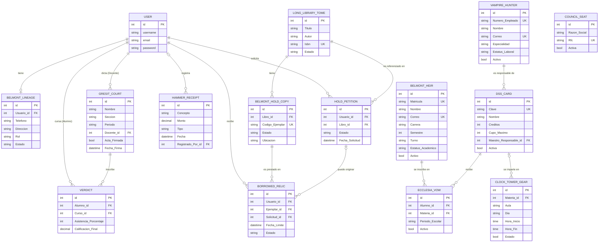

# Base de datos

## Motor

**PostgreSQL 16** en producción (contenedor `db`, ver [`docs/02-instalacion-y-despliegue.md`](02-instalacion-y-despliegue.md)); **SQLite** como *fallback* automático cuando no hay `POSTGRES_DB` definida, para desarrollo sin contenedores. El motor se decide en `config/settings.py` según esa variable de entorno, el resto del código (modelos, vistas, migraciones) es idéntico en ambos casos gracias al ORM de Django.

## Nombres de modelos, tablas y columnas

Los modelos siguen el estilo de nombres del proyecto (temática de *Castlevania*, Pascal_Snake_Case, ver [`docs/08-desarrollo-y-contribucion.md`](08-desarrollo-y-contribucion.md)). Los campos conservan su nombre descriptivo en español, solo en Pascal_Snake_Case (`fecha_limite` → `Fecha_Limite`).

| App | Modelo | Qué representa | Tabla |
|---|---|---|---|
| `usuarios` | `Belmont_Lineage` | Perfil: rol y estado de una cuenta | `usuarios_belmont_lineage` |
| `alumnos_maestros` | `Belmont_Heir` | Alumno | `alumnos_maestros_belmont_heir` |
| `alumnos_maestros` | `Vampire_Hunter` | Maestro | `alumnos_maestros_vampire_hunter` |
| `alumnos_maestros` | `DSS_Card` | Materia | `alumnos_maestros_dss_card` |
| `alumnos_maestros` | `Ecclesia_Vow` | Inscripción de un alumno a una materia en un periodo | `alumnos_maestros_ecclesia_vow` |
| `calificaciones` | `Gresit_Court` | Curso (sección) con su acta | `calificaciones_gresit_court` |
| `calificaciones` | `Verdict` | Calificación y asistencia de un alumno en un curso | `calificaciones_verdict` |
| `horarios` | `Clock_Tower_Gear` | Bloque de horario semanal | `horarios_clock_tower_gear` |
| `empresas` | `Council_Seat` | Empresa vinculada | `empresas_council_seat` |
| `billetera` | `Hammer_Receipt` | Movimiento de ingreso o egreso | `billetera_hammer_receipt` |
| `libros` | `Long_Library_Tome` | Título del catálogo | `libros_long_library_tome` |
| `libros` | `Belmont_Hold_Copy` | Ejemplar físico de un título | `libros_belmont_hold_copy` |
| `prestamos` | `Hold_Petition` | Solicitud de préstamo | `prestamos_hold_petition` |
| `prestamos` | `Borrowed_Relic` | Préstamo de un ejemplar | `prestamos_borrowed_relic` |

En PostgreSQL las columnas con mayúsculas se guardan entre comillas (`"Fecha_Limite"`). El ORM lo hace solo; en SQL escrito a mano hay que citarlas: `SELECT "Titulo" FROM libros_long_library_tome;`.

## Diagrama entidad-relación

Fuente: [`docs/diagramas/04-er-base-de-datos.mmd`](diagramas/04-er-base-de-datos.mmd) (renderizado en el `.png` del mismo nombre).



`COUNCIL_SEAT` es la única tabla sin relaciones: las empresas no se cruzan con ningún otro módulo. `HAMMER_RECEIPT` solo se liga al usuario que registró el movimiento, y `CLOCK_TOWER_GEAR` a la materia que se imparte (opcional, para conservar los horarios previos a esa relación).

## Descripción por módulo

### `usuarios`: `Belmont_Lineage`
Extiende `django.contrib.auth.User` vía `OneToOneField` (`user.Belmont_Lineage`). Guarda `Rol` (`USUARIO`/`ADMIN`), `Estado` (`ACTIVO`/`BAJA`), teléfono y dirección. Es la tabla que consulta `es_admin()` en cada chequeo de autorización, y un `Estado` en `BAJA` impide iniciar sesión.

### `alumnos_maestros`: `Belmont_Heir`, `Vampire_Hunter`, `DSS_Card`, `Ecclesia_Vow`
El módulo con el modelo de datos más completo del sistema. Puntos a destacar:
- `Belmont_Heir.Matricula` y `Vampire_Hunter.Numero_Empleado` se **autogeneran** en `save()` con formato `ALU-{año}-{consecutivo}` / `DOC-{año}-{consecutivo}` si vienen vacíos (`Belmont_Family_Tree` calcula el siguiente; `Mist_Form` reintenta si dos altas simultáneas chocan con el `unique`).
- `DSS_Card.Maestro_Responsable` usa `on_delete=models.PROTECT`: no se puede borrar un maestro que tenga materias asignadas.
- `Ecclesia_Vow` tiene una `UniqueConstraint` condicional (`inscripcion_activa_unica`): un alumno no puede tener dos inscripciones **activas** a la misma materia en el mismo periodo, pero sí inscripciones canceladas históricas. El cupo (`DSS_Card.Cupo_Maximo`) se valida en el formulario y se revalida con la materia bloqueada (`select_for_update`) al guardar.

### `calificaciones`: `Gresit_Court`, `Verdict`
`Gresit_Court.Docente` y `Verdict.Alumno` son FK directas a `User` con `on_delete=models.PROTECT`: un acta firmada es un documento oficial y no desaparece al borrar una cuenta. `Verdict.Calificacion_Final` tiene validadores de modelo (`MinValueValidator(0)`, `MaxValueValidator(10)`) que **no se aplican solos** con un `.save()` directo: la vista `The_Judge` llama a `full_clean()` en cada fila y guarda todo o nada.

### `horarios`: `Clock_Tower_Gear`
Día de la semana, hora de inicio y fin, aula, estado, y la materia que se imparte (`Materia`, FK opcional a `DSS_Card`). Las reglas de horario viven en el formulario `Galamoth` (`horarios/Out_Of_Time.py`): fin posterior al inicio, y sin traslape con un horario activo de la misma materia, el mismo maestro o la misma aula. Un horario creado fuera de ese formulario (shell, migración de datos) no queda protegido automáticamente.

### `empresas`: `Council_Seat`
`Rfc` es único a nivel de base de datos y se valida en formato (`Lenore_Treaty.clean_Rfc`, patrón `[A-ZÑ&]{3,4}\d{6}[A-Z0-9]{3}`): valida forma, no el dígito verificador del SAT.

### `billetera`: `Hammer_Receipt`
`Monto` es un `DecimalField` sin rango a nivel de modelo; el formulario (`Hammer_Ledger.clean_Monto`) exige que sea mayor a cero. `Registrado_Por` guarda quién capturó el movimiento (nulo solo en los registros previos a ese campo). Los movimientos no se editan ni se borran desde el admin: un error se corrige con un movimiento inverso. Los totales se calculan con una agregación en la base de datos (`Hammer_Counts`).

### `libros`: `Long_Library_Tome`, `Belmont_Hold_Copy`
Un título puede tener varios ejemplares (copias físicas, `Ejemplares`). El estado del ejemplar (`DISPONIBLE`/`PRESTADO`/`DAÑADO`/`BAJA`) determina si se puede prestar; `PRESTADO` solo lo ponen y quitan los flujos de préstamo. Dar de baja un título (`Seal_The_Tome`) retira sus ejemplares y rechaza sus solicitudes pendientes, y se bloquea si tiene ejemplares prestados. `Belmont_Hold_Copy.Libro` usa `PROTECT` para no perder el historial de préstamos.

### `prestamos`: `Hold_Petition`, `Borrowed_Relic`
Un préstamo puede o no tener una solicitud de origen (`Solicitud`, `on_delete=models.SET_NULL`): los préstamos en mostrador no la tienen. Las transiciones (`PENDIENTE → APROBADA/RECHAZADA/CANCELADA`, `ACTIVO → DEVUELTO`) viven en `prestamos/Death_Ballad.py` y releen su fila con `select_for_update()` dentro de la transacción, para que un doble clic no preste ni devuelva dos veces. `Borrowed_Relic.esta_vencido` se calcula al vuelo (activo y con `Fecha_Limite` pasada).

## Migraciones

Cada app mantiene sus propias migraciones bajo `<app>/migrations/`. Para aplicar cambios de modelo:

```bash
python manage.py makemigrations <app>
python manage.py migrate
```

Con contenedores, correr estos comandos dentro del contenedor: `docker compose exec web python manage.py makemigrations` (o `podman compose exec ...`).

**Migraciones de renombrado:** el cambio a los nombres actuales se hizo con migraciones escritas a mano que solo usan `RenameModel`/`RenameField` (`usuarios/0002_belmont_lineage`, `alumnos_maestros/0002_the_circle`, `calificaciones/0004_the_court`, `horarios/0003_clock_tower`, `empresas/0002_council_seat`, `billetera/0003_hammer_receipt`, `libros/0003_long_library`, `prestamos/0003_the_hold`): ningún dato se borra ni se vuelve a crear. Dos de ellas declaran dependencias cruzadas (`alumnos_maestros/0002` después de `horarios/0002`, `libros/0003` después de `prestamos/0002`) porque esas migraciones anteriores todavía nombran los modelos viejos; sin ese orden, una base de datos nueva fallaba al migrar. Antes de aplicarlas en producción, respaldar la base de datos.

**Nota histórica:** `calificaciones` tiene una migración (`0002_alumnocurso_curso_delete_registro_alumnocurso_curso_and_more`) que borra un modelo `Registro` anterior al rediseño del módulo. El formulario que todavía lo referenciaba quedó roto (`ImportError` si algo lo importaba) hasta que se eliminó en la auditoría, ejemplo real de por qué conviene revisar que no queden referencias a un modelo antes de borrarlo en una migración.
