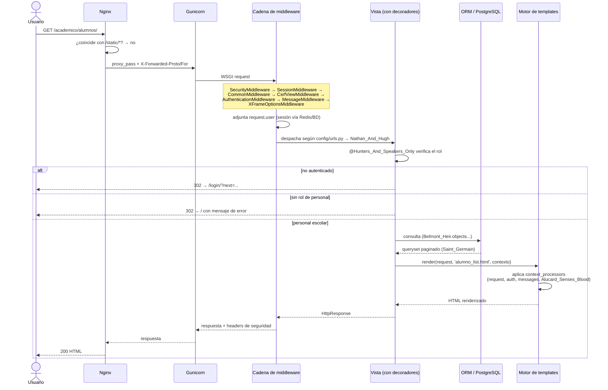

# Rutas y vistas

## Por qué este documento no se llama "documentación de API"

Sistema Escolar **no expone una API REST/JSON**. Es un sitio Django tradicional: cada ruta renderiza HTML en el servidor y el navegador hace *submits* de formularios normales. El único endpoint que devuelve JSON es `/healthz/` (pensado para que lo consulte Podman o un balanceador, no una persona). Si en el futuro se necesita una API real (por ejemplo, para una app móvil), el candidato natural es agregar Django REST Framework como una capa nueva, hoy no existe.

## Ciclo de vida de una petición

## Mapa de rutas

Prefijo raíz definido en `config/urls.py`. `Auth` indica el nivel de acceso real verificado en la vista (no solo lo que muestra el menú).

### Raíz (`config/urls.py`)

| Ruta | Nombre | Auth | Descripción |
|---|---|---|---|
| `GET /healthz/` | `Lisa_Tepes` | Ninguna | Verifica app + conexión a BD. Usado por Podman/balanceador. |
| `/admin/` | - | Staff de Django | Admin nativo de Django |
| `GET,POST /login/` | `Cerberus_Gate` | Ninguna | Login (`LoginView` con bloqueo por intentos) |
| `POST /logout/` | `Leave_The_Castle` | Cualquier autenticado | Cierra sesión (requiere POST) |
| `GET /` | `Greta` | `@login_required` | Panel principal con los módulos disponibles |

### `/academico/`: `alumnos_maestros`

| Ruta | Nombre | Auth |
|---|---|---|
| `GET /academico/` | `Circle_Of_The_Moon` | Personal (admin o docente) |
| `GET /academico/alumnos/` | `Nathan_And_Hugh` | Personal (admin o docente) |
| `GET,POST /academico/alumnos/nuevo/` | `Morris_Takes_An_Apprentice` | Admin |
| `GET,POST /academico/alumnos/<pk>/editar/` | `Nathan_Levels_Up` | Admin |
| `POST /academico/alumnos/<pk>/desactivar/` | `Hugh_Goes_His_Own_Way` | Admin |
| `GET /academico/maestros/` | `Morris_Baldwin` | Personal (admin o docente) |
| `GET,POST /academico/maestros/nuevo/` | `Morris_Recruits` | Admin |
| `GET,POST /academico/maestros/<pk>/editar/` | `Morris_Revises` | Admin |
| `POST /academico/maestros/<pk>/desactivar/` | `Julius_Retires` | Admin |
| `GET /academico/materias/` | `Charlotte_Spellbook` | Personal (admin o docente) |
| `GET,POST /academico/materias/nueva/` | `Charlotte_Learns_A_Spell` | Admin |
| `GET,POST /academico/materias/<pk>/editar/` | `Charlotte_Rewrites_A_Spell` | Admin |
| `POST /academico/materias/<pk>/desactivar/` | `Charlotte_Seals_A_Spell` | Admin |
| `GET /academico/inscripciones/` | `Order_Of_Ecclesia` | Personal (admin o docente) |
| `GET,POST /academico/inscripciones/nueva/` | `Join_The_Order` | Admin |
| `POST /academico/inscripciones/<pk>/desactivar/` | `Leave_The_Order` | Admin |

### `/calificaciones/`

| Ruta | Nombre | Auth |
|---|---|---|
| `GET /calificaciones/dashboard/` | `Alucard_Teaches` | Autenticado (vista distinta si es docente o alumno) |
| `GET,POST /calificaciones/curso/<id>/calificaciones/` | `The_Judge` | Solo el docente del curso |
| `POST /calificaciones/curso/<id>/iniciar-firma/` | `Lenore_Sends_Word` | Solo el docente del curso (envía el código por correo) |
| `GET,POST /calificaciones/curso/<id>/firmar/` | `Leon_Seals_The_Vow` | Solo el docente del curso |
| `GET /calificaciones/curso/<id>/pdf/` | `Speakers_Record` | Docente del curso o alumno inscrito |

### `/horarios/`

| Ruta | Nombre | Auth |
|---|---|---|
| `GET,POST /horarios/` | `Clock_Tower` | Lectura: autenticado. Creación (POST): admin |
| `GET,POST /horarios/editar/<id>/` | `Rewind_The_Clock` | Admin |
| `POST /horarios/eliminar/<id>/` | `Stop_The_Clock` | Admin |

### `/empresas/`

| Ruta | Nombre | Auth |
|---|---|---|
| `GET /empresas/` | `Council_Of_Sisters` | Personal (admin o docente) |
| `GET,POST /empresas/nueva/` | `Lenore_Signs_A_Pact` | Admin |
| `GET,POST /empresas/<pk>/editar/` | `Lenore_Renegotiates` | Admin |

### `/billetera/`

| Ruta | Nombre | Auth |
|---|---|---|
| `GET /billetera/` | `Hammer` | Admin |
| `GET,POST /billetera/nuevo/` | `Hammer_Rings_It_Up` | Admin |

### `/libros/`

| Ruta | Nombre | Auth |
|---|---|---|
| `GET /libros/` | `Master_Librarian` | Autenticado |
| `GET,POST /libros/nuevo/` | `Librarian_Shelves_A_Tome` | Admin |
| `GET,POST /libros/editar/<id>/` | `Librarian_Mends_A_Tome` | Admin |
| `POST /libros/eliminar/<id>/` | `Librarian_Retires_A_Tome` | Admin |
| `GET /libros/ejemplares/` | `Alucard_Counts_The_Hold` | Admin |
| `GET,POST /libros/ejemplares/nuevo/` | `Alucard_Adds_A_Copy` | Admin |
| `GET,POST /libros/ejemplares/editar/<id>/` | `Alucard_Restores_A_Copy` | Admin |
| `POST /libros/ejemplares/eliminar/<id>/` | `Alucard_Retires_A_Copy` | Admin |

### `/prestamos/`

| Ruta | Nombre | Auth |
|---|---|---|
| `GET,POST /prestamos/solicitar/` | `Trevor_Requests_A_Tome` | Autenticado (`?libro=<id>` lo preselecciona) |
| `GET /prestamos/mis-prestamos/` | `Trevor_Satchel` | Autenticado (solo lo propio) |
| `POST /prestamos/solicitudes/<id>/cancelar/` | `Trevor_Changes_His_Mind` | El dueño de la solicitud |
| `GET /prestamos/solicitudes/` | `Librarian_Queue` | Admin (`?estado=` filtra; por defecto, pendientes) |
| `POST /prestamos/solicitudes/aprobar/<id>/` | `Alucard_Opens_The_Hold` | Admin |
| `POST /prestamos/solicitudes/rechazar/<id>/` | `Alucard_Bars_The_Door` | Admin |
| `GET,POST /prestamos/registrar/` | `Librarian_Hands_It_Over` | Admin |
| `GET /prestamos/activos/` | `Death_Ledger` | Admin |
| `POST /prestamos/devolver/<id>/` | `Return_To_The_Hold` | Admin (`danado=1` lo recibe como dañado) |

### `/usuarios/`

| Ruta | Nombre | Auth |
|---|---|---|
| `GET,POST /usuarios/registro/` | `Sypha_Joins_The_Party` | Público (redirige si ya está autenticado) |
| `GET,POST /usuarios/perfil/` | `Trevor_Shows_The_Crest` | Autenticado (edita nombre, correo y contacto) |

## Convención de acciones destructivas

Toda acción que cambia estado (desactivar, eliminar, aprobar, rechazar, registrar devolución) **exige POST**, decorada con `@require_POST` además de su guardia de acceso (`@Belmont_Blood_Only`, o `@login_required` cuando el lector actúa sobre lo suyo, como cancelar su solicitud). Ningún enlace `<a href>` dispara una mutación, las plantillas envían estas acciones como formularios con ``. Esto no siempre fue así: la auditoría de seguridad encontró varias de estas acciones disparándose con un simple GET (ver `docs/09-estado-del-proyecto.md`).
